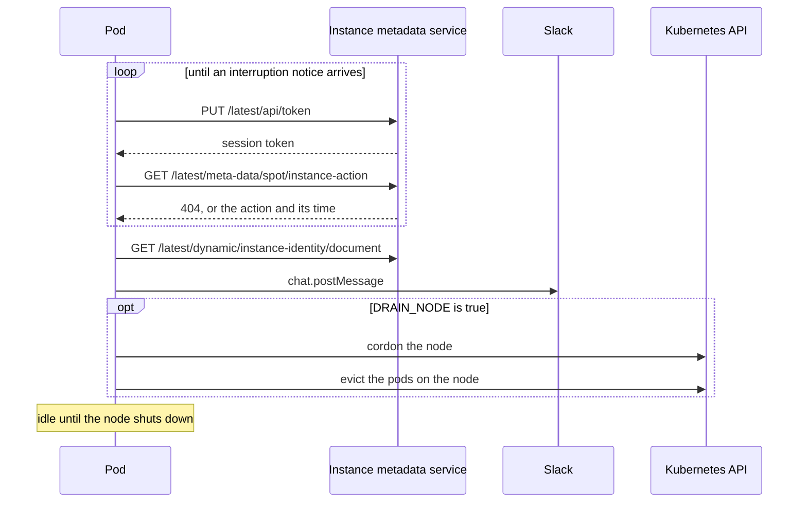

# Architecture

Each node runs one pod of the DaemonSet, and each pod reads the instance metadata service of the
EC2 instance under it. AWS publishes an interruption notice at `meta-data/spot/instance-action`
two minutes before it stops or terminates a Spot Instance. The pod acts on that notice once and
waits for the node to go away.

## Polling

The pod polls every 5 seconds. Each poll asks for an IMDSv2 session token with a `PUT` to
`/latest/api/token` and reads `instance-action` with that token. If the token request fails or
returns a status other than `200`, the pod reads the same path without a token, as IMDSv1 allows.
An instance that requires IMDSv2 answers that read with `401`, which the pod treats as no notice.

The metadata service answers `404` until AWS marks the instance. From that moment it returns a JSON
document that holds the `action` and the `time` of the interruption.

## Actions

| `action` | Response |
| --- | --- |
| `terminate` | the pod notifies Slack and, with draining enabled, drains the node |
| `stop` | the pod notifies Slack and, with draining enabled, drains the node |
| `hibernate` | none, the pod keeps polling |

The service does not read rebalance recommendations, which AWS can send ahead of an interruption
notice.

## Notification

The pod reads the instance identity document for the instance ID, account ID, Availability Zone
and instance type, and posts them to Slack with `chat.postMessage`. A failed message is logged,
and the drain goes ahead without it. [Configuration](configuration.md#slack) describes the Slack
app and the message.

## After an interruption

The pod handles an interruption once. After the message and the drain, it logs
`Interruption handled, waiting for the node to shut down` and sleeps until the node goes away. A
restarted process would read the same notice and send a second message, so the process keeps
running and the liveness probe keeps passing.

A `SIGTERM` ends the process at once with exit code 0, even in the middle of a drain.

## Image

The `Dockerfile` installs the locked runtime dependencies from `uv.lock` into a virtual
environment with uv, on an Alpine Python base image. The image runs `python spot.py` as UID 10001.
CI builds it for `linux/amd64` and `linux/arm64`.

## Kubernetes

The DaemonSet places a pod on every `amd64` and `arm64` node that has no taint it cannot tolerate.
On an On-Demand instance the `instance-action` endpoint never returns a notice, so a pod there
polls without effect. [Deploying on Kubernetes](deploying.md#spot-nodes-only) shows how to keep
the pods to Spot nodes.

The pod calls the Kubernetes API only to drain its node, with the permissions that `rbac.yml`
grants its ServiceAccount.
